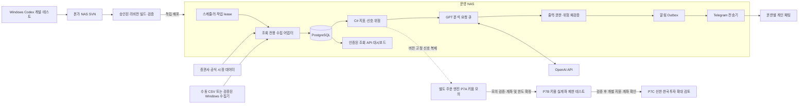
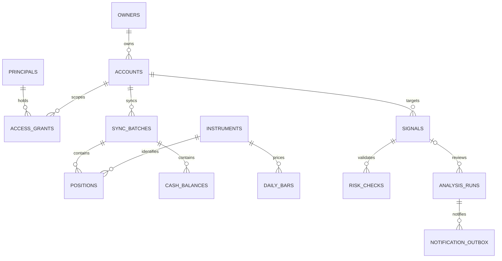
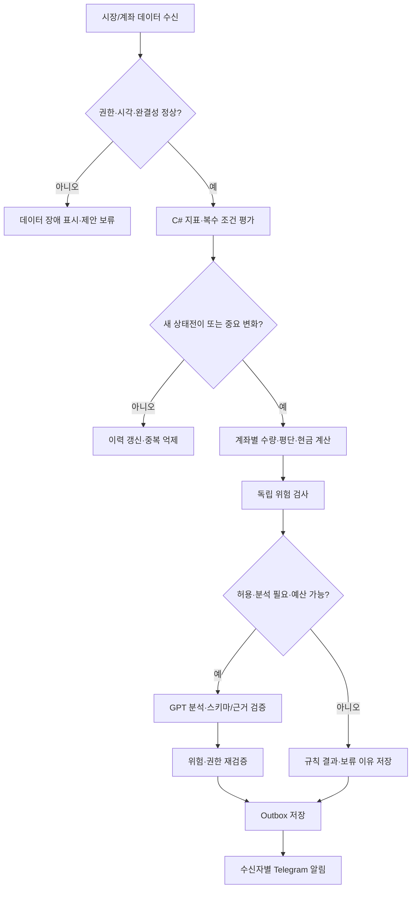

# NAS 기반 AI 주식 모니터링 및 자동매매 시스템

소프트웨어 요구사항 명세서(SRS) 및 기술 설계서 · v1.2 · 2026-10-26 KST

문서 상태: **구현 기준안 작성 완료 / 외부 연동 및 실기 인수 미실행**. 이 문서의 설계·성능 목표는 권장안이며, 증권사 지원 확정이나 운영 검증 완료를 뜻하지 않는다. 계좌번호, 토큰, 실명 및 실제 투자금액은 포함하지 않는다.

원본: 사용자가 제공한 「시스템 명세서 작성」 대화. 원문은 1~13번 요구사항 묶음과 13번 안의 20개 결과물 목차로 구성되어 있다. 이 문서는 요청한 20개 결과물 순서를 따르고, 원문 요구사항을 FR/NFR 및 부록 추적표에 연결한다. 요청의 “TSV/SVN”은 TSV 요구사항 추적표와 SVN 개발 절차를 모두 포함하는 것으로 해석한다. TSV는 버전 관리 도구가 아니다.

## 1. 프로젝트 개요 및 목표

운영 NAS를 실행 주체로 하여 6개 투자 계좌의 잔고와 시장 데이터를 수집하고, C#/.NET으로 기술지표·손익·위험을 계산한다. 중요한 사건에 한해 OpenAI API 분석을 수행하고, 권한에 맞춘 Telegram 알림을 전달한다. Windows PC는 개발·테스트·SVN 작업을 담당한다. 본가 NAS의 SVN 서버와 운영 NAS는 별개이다.

Phase 1~6의 제품은 **조회·분석·알림 전용**이다. 주문 인터페이스, 주문 자격증명 및 주문 실행 컨테이너를 모니터링 배포물에 포함하지 않는다. Phase 7의 주문 엔진은 별도 프로젝트로 개발하며 **P7A 키움증권 모의계좌 검증 → P7B 키움증권 실계좌의 제한된 예수금으로 테스트 → P7C 검증 후 신한투자증권·한국투자증권으로 확대 검토** 순서로 진행한다. 신한투자증권·한국투자증권은 P7A/B 동안에도 모니터링 전용이다. GPT의 판단은 어떠한 단계에서도 위험 관리 규칙을 무시할 권한을 갖지 않는다.

v1.1 사용자 확정 사항: 키움 모의·실계좌 테스트 순서와 타 증권사 주문 도입 유예. 키움 실계좌 투입 예수금·주문 한도·대상 시장·종목·전환 날짜는 미확정이다. 향후 실계좌 테스트 계획은 확정된 개발 범위이며, 현재 실제 주문을 실행하라는 지시로 해석하지 않는다. 단계 전환 시 구체 계좌와 한도 및 시험 결과를 기록한다.

v1.2 사용자 확정 사항: 애플리케이션 개발 언어를 Python에서 **C#/.NET**으로 변경한다. 원본의 Python 지정은 이 후속 결정으로 대체한다. 지금은 계획·명세 반영 단계이며 실제 프로젝트 생성·SDK 설치·프로그램 구현은 프로젝트 설정 완료 후 별도 작업으로 시작한다. 계좌 범위·자동매매 검증 순서·보안 및 인수 조건은 유지한다. .NET Framework나 Windows 전용 UI를 NAS 서버의 실행 기반으로 사용하지 않는다.

핵심 성공 기준은 계좌 원본 보존, 명의별 손익·현금 분리, 허가된 범위의 중복 노출 분석, 재현 가능한 신호, 신뢰할 수 있는 데이터 기준 시각, 장애 복구이다. 투자 수익률 자체를 소프트웨어 인수 기준으로 삼지 않는다.

### 1.1 대상 계좌

| 계좌 | 증권사 | 종류 | 소유자 | 최초 연결 단계 | 기본 상태 |
|---|---|---|---|---|---|
| ACC-01 | 한국투자증권 | ISA | OWNER-SELF | P3 | 상품별 조회 검증 대기 |
| ACC-02 | 한국투자증권 | 국내 일반 1 | OWNER-SELF | P2 | 최초 읽기 전용 PoC 대상 |
| ACC-03 | 한국투자증권 | 해외 일반 1 | OWNER-SELF | P3 | 국가·통화·계좌 연결 검증 대기 |
| ACC-04 | 신한투자증권 | 국내 일반 2 | OWNER-SELF | P3 | API 검증 전 CSV 지원 |
| ACC-05 | 한국투자증권 | 국내 일반 3 | OWNER-A | P3 | 별도 동의·인증·수신권한 검증 대기 |
| ACC-06 | 한국투자증권 | 개인연금저축 | OWNER-SELF | P3 | 연금 상품별 조회 검증 대기 |

본인 명의 한국투자증권 계좌는 4개(01·02·03·06)이다. 논리 계좌 ID와 증권사의 종합계좌·상품코드는 일대일이라고 가정하지 않고 등록 시 매핑한다. 기존 모니터링 대상 6개는 유지하며, 키움 테스트 계좌는 별도로 등록한다. `KIWOOM-DEMO-01`은 P7A 모의계좌, `KIWOOM-LIVE-01`은 P7B 실계좌용 권장 논리 ID이며 실제 계좌 개설·연결 완료를 뜻하지 않는다. 모의 자산은 실자산 포트폴리오 합계에서 제외하고, 키움 실계좌는 연결 후 권한 범위에 따라 실자산 집계에 포함한다.

## 2. 확정 요구사항과 미확정 사항

### 2.1 상태 표기

- **U — 사용자 확정**: 사용자 제공 환경·기능·정책. 실기 확인과는 구분한다.
- **D — 공식 문서 확인**: 이번 작성 시 공식 페이지 또는 공식 예제 본문에서 확인. 실제 계좌 사용 가능성을 보증하지 않는다.
- **I — 부분 확인**: 공식 검색 결과나 서비스 소개까지 확인했으나 세부 본문·조건이 불완전하다.
- **P — 추가 검증 필요**: 계정, 상품, 계약, NAS 실기, 호출 제한 또는 PoC 확인이 필요하다.
- **R — 권장 설계**: 본 문서가 제안하는 내부 구현 방식·수치. 사용자 확정 사실이나 증권사 정책이 아니다.

EXT-01~14의 외부 API·NAS 문서 확인일은 2026-10-22 KST이며 v1.2에서 재검증한 것으로 간주하지 않는다. C#/.NET 전환 관련 문서(EXT-15~17)는 2026-10-26 KST 확인이다. 공개 페이지는 지속 변경되므로 배포 직전에 재확인하고 URL·확인일·해당 API ID·문서 해시 또는 허용되는 화면 기록을 증거로 보관한다. 계좌 로그인, 토큰 발급, 모의주문, NAS 접속은 수행하지 않았다.

### 2.2 공식 문서 검증 결과

| ID | 대상 및 확인 내용 | 상태 | 구현에 적용할 결론 및 남은 검증 |
|---|---|---|---|
| EXT-01 | KIS 공식 저장소는 국내·해외주식, 인증, ETF/ETN 등의 예제를 제공한다. 실전·모의 인증 설정을 구분한다. [공식 저장소](https://github.com/koreainvestment/open-trading-api) | D/P | REST 기반 NAS 어댑터를 우선 설계. 상품별 이용신청, 호출 한도, 데이터 권한은 별도 확인 |
| EXT-02 | 국내 잔고 예제에 real/demo 및 연속조회가 있다. [국내 잔고 예제](https://github.com/koreainvestment/open-trading-api/blob/main/examples_llm/domestic_stock/inquire_balance/inquire_balance.py) | D/P | 모의 국내 잔고 조회 경로 존재. ACC-02 실조회, 페이지 완결성, 현금 필드 의미를 PoC |
| EXT-03 | 해외 잔고 예제에 real/demo와 거래소·통화 인수가 있다. [해외 잔고 예제](https://github.com/koreainvestment/open-trading-api/blob/main/examples_llm/overseas_stock/inquire_balance/inquire_balance.py) | D/P | 해외 모의 잔고 경로 존재. 이 사실만으로 모든 해외 시장·주문 유형의 모의 지원을 확정하지 않음 |
| EXT-04 | KIS 예제에 개인연금 상품코드 설정이 존재하지만 실제 ISA·연금 고객 계좌에 대한 모든 조회 기능을 입증하지 않는다. [공식 설정 안내](https://github.com/koreainvestment/open-trading-api) | I/P | ISA·연금·타명의·키당 연결 가능 계좌 범위는 계좌별 승인·조회 검증 전 비활성 |
| EXT-05 | 신한 공식 홈트레이딩 안내에는 신한i indi가 표시된다. 상세 indi 페이지는 본문 확보가 제한됨. [홈트레이딩](https://ir.shinhaninvest.com/siw/customer-center/channel/channel_homeTrading-mini/contents.do), [indi 상세](https://ir.shinhaninvest.com/siw/customer-center/channel/channel_homeTrading-indi/contents.do) | I/P | 개인 잔고 API 신청 조건, Linux/REST, Windows 구성, 모의투자 지원 상품·TR·운영 여부 모두 추가 검증. “신한 API 없음”으로 단정하지 않음 |
| EXT-06 | 신한은행·그룹 Open API와 마이데이터 목록은 신한투자증권 개인 자동화 API의 사용 허가를 뜻하지 않는다. [신한 Open API 가이드](https://openapi.shinhan.com/dev-guide) | D/P | 은행·제휴 API를 ACC-04 개인 잔고 조회 가능 근거로 사용하지 않음 |
| EXT-07 | 키움 국내 주문체결 WebSocket 문서의 모의 도메인은 KRX 한정으로 표시된다. [국내 주문체결](https://openapi.kiwoom.com/m/guide/apiguide/14/00) | D/P | 국내 모의시장의 NXT·SOR 지원을 가정하지 않음. 주문·취소·체결 TR별 PoC |
| EXT-08 | 키움 미국주식 원장잔고확인 ust21070에 모의 도메인이 명시된다. 공식 저장소에 국내·미국 조회 및 주문 예제가 존재한다. [미국 잔고](https://openapi.kiwoom.com/guide/apiGuideContents/32/ust21070), [공식 저장소](https://github.com/Kiwoom-Securities/Kiwoom-REST-API/blob/main/README.md) | D/P | “키움 REST는 국내만”이라고 단정하지 않음. 미국 모의주문의 세부 상품·시간·수량·체결 모델은 별도 검증 |
| EXT-09 | 키움 모의투자 안내 검색 결과는 미국 NYSE/NASDAQ/AMEX 범위를 언급하나 페이지 본문은 메뉴 중심으로만 추출됨. [모의투자 안내](https://openapi.kiwoom.com/intro/mockInvestInfo?dummyVal=0) | I/P | 미국 지원 거래소는 잠정 범위로 기록. 로그인 가능한 공식 안내에서 재확인 |
| EXT-10 | Synology Container Manager 공식 패키지 검색 결과의 적용 모델에 DS718+가 포함되나 본문 추출은 제한됨. [패키지](https://www.synology.com/en-us/dsm/packages/ContainerManager) | I/P | 모델 지원 목록 확인과 사용 NAS의 DSM·패키지 설치 가능 여부를 분리. DSM 버전 확인 후 패키지 센터에서 확정 |
| EXT-11 | DS718+ 데이터시트는 Intel Celeron J3455와 메모리 최대 확장 6GB를 명시한다. [공식 데이터시트](https://global.download.synology.com/download/Document/Hardware/DataSheet/DiskStation/18-year/DS718%2B/enu/Synology_DS718_Plus_Data_Sheet_enu.pdf) | D/U/P | 사용자가 설치한 16GB는 U, 공식 지원 용량은 아님. 실제 인식·장시간 부하·메모리 진단 필요. linux/amd64 이미지를 권장하되 실기 확인 |
| EXT-12 | OpenAI는 JSON Schema 기반 Structured Outputs를 지원하고 지원 스키마에 제약이 있다. 거부·불완전 응답은 별도 처리한다. [공식 가이드](https://developers.openai.com/api/docs/guides/structured-outputs) | D/P | Responses API의 text.format 기반 출력 계약을 사용. 모델·.NET SDK 또는 HTTP 클라이언트·스키마 조합을 고정해 PoC. 사실성·금액 정확성은 C# 검증 |
| EXT-13 | Telegram Bot API는 HTTPS 기반 sendMessage, 문자 길이 제한, 오류 시 retry_after 등을 문서화한다. [Bot API](https://core.telegram.org/bots/api) | D/P | 4,096자 이하 분할, 수신자 사전 등록, 제한 응답 대응. 전달 보장과 중복 0회를 단정하지 않음 |
| EXT-14 | Compose는 서비스별 secrets 파일 제공을 지원한다. [Docker secrets](https://docs.docker.com/compose/how-tos/use-secrets/) | D/P | NAS의 원본 파일 암호화·ACL은 별도 필요. Compose secrets 자체를 비밀 저장소 암호화로 오인하지 않음 |
| EXT-15 | .NET 10은 LTS이며 .NET 8/9보다 지원 종료가 늦다. [Microsoft 지원 정책](https://dotnet.microsoft.com/en-us/platform/support/policy) | D/R/P | 신규 서버의 기본 권장안은 .NET 10 LTS. 실제 SDK·런타임 패치 및 이미지 digest는 프로젝트 설정 단계에서 확정 |
| EXT-16 | .NET의 BackgroundService/IHostedService는 플랫폼 간 백그라운드 서비스 구성을 지원한다. [Microsoft Worker 문서](https://learn.microsoft.com/en-us/dotnet/core/extensions/workers) | D/R/P | 수집·분석 worker는 .NET Generic Host 기반으로 설계. Linux 컨테이너의 DS718+ 기동·메모리·TLS는 실기 검증 필요 |
| EXT-17 | Worker 공식 문서는 SDK 빌드 단계와 runtime 실행 단계를 나눈 컨테이너 예제를 제공한다. [Worker 컨테이너 안내](https://learn.microsoft.com/en-us/dotnet/core/extensions/workers#containers-and-cloud-adaptability) | D/R/P | 다단계 빌드와 비root 실행을 권장. API가 ASP.NET Core를 사용하면 aspnet 런타임 이미지가 필요. NAS 패키지 호환성 보증은 아님 |

호출 제한 숫자는 계정·서비스별 변경 가능하므로 이 문서에서 임의로 고정하지 않는다. 검증된 한도를 환경/명의/앱키/토큰/API 그룹별 설정으로 등록하고 초기값은 단일 호출 직렬 처리로 시작한다. 계좌별 지원이 미확정이어도 공통 모델·CSV·가짜 어댑터 구현은 진행할 수 있다.

## 3. 기능 요구사항(FR)

우선순위: P0=해당 단계 출시 차단 요건, P1=해당 단계 필수 기능, P2=확장 기능. 단계 P1~P7은 16장과 연결되며 P7은 A/B/C로 구분한다. 표의 검증은 **예정된 검증 방법**이며 완료 표시가 아니다. 아래 세부 절의 규칙은 해당 FR의 일부이다.

| ID | 요구사항 및 합격 조건 요약 | 우선순위 | 단계 | 의존성 | 검증 방법 |
|---|---|---|---|---|---|
| FR-001 | 6개 논리 계좌·명의·상품·통화 등록, 실제 계좌 식별정보는 비밀 참조로 저장 | P0 | P1 | NFR-001 | T01 등록·중복·노출 검사 |
| FR-002 | ACC-02 KIS 읽기 전용 인증·토큰 갱신·잔고 전 페이지 동기화 | P0 | P2 | FR-001, EXT-02 | T02 공식 화면 대조 |
| FR-003 | ACC-01/03/06 개별 capability 검증 및 지원된 기능만 활성화 | P0 | P3 | FR-002, EXT-03/04 | T03 계좌별 PoC |
| FR-004 | ACC-05 별도 동의·키·토큰·권한·수신자 사용 | P0 | P3 | FR-001, NFR-002 | T04 교차 접근 거절 |
| FR-005 | ACC-04 신한 API 검증, 가능 시 NAS 연결 또는 Windows 수집기 연계 | P1 | P3 | EXT-05, NFR-002 | T05 공식 답변·수집 PoC |
| FR-006 | API 미지원 계좌 CSV/TSV 가져오기·미리보기·검증·중복 방지·취소 | P1 | P3 | FR-001 | T06 불량 파일·재수입 |
| FR-007 | 원본 보유·현금·동기화 배치 보존, 불완전 배치는 최신 정상 스냅샷 대체 금지 | P0 | P2 | FR-002 | T02 페이지 중단 시험 |
| FR-008 | 수량·평균단가·평가액·손익·수익률·예수금·주문가능금액·시각 제공 | P1 | P2 | FR-007 | T07 계산·대사 |
| FR-009 | 명의별 손익과 매수가능금액 분리, 계좌 간 현금 이동 가정 금지 | P0 | P3 | FR-008, NFR-002 | T04/T07 |
| FR-010 | 동일 종목 총수량·가중평균단가·계좌 원본 병행 조회 | P1 | P3 | FR-008 | T07 2계좌 계산 |
| FR-011 | 허가된 계좌의 종목·업종 집중도, ETF 구성 기반 중복 노출 및 불확실성 표시 | P1 | P3 | FR-010, FR-016 | T08 노출·누락 비중 |
| FR-012 | 해외 자산 KRW 환산에 환율·출처·기준 시각, 실현/평가손익·비용 반영 상태 구분 | P1 | P3 | FR-008, FR-015 | T07 환율·원가 시험 |
| FR-013 | 국내 실시간/지연 시세·일 OHLCV·거래량·거래대금·KOSPI/KOSDAQ 수집 | P1 | P2 | FR-002 | T09 지연·결측·역순 |
| FR-014 | 외국인·기관·프로그램 수급, 공시·실적 수집 및 제공불가 상태 표시 | P1 | P4 | FR-013, EXT-01 | T09 출처·필드 대조 |
| FR-015 | 미국 주식/ETF·S&P500·나스닥·SOX·국채금리·USD/KRW·경제지표·실적 수집 | P1 | P3~4 | FR-003, 공급원 PoC | T09 각 데이터 계약 검증 |
| FR-016 | 종목 마스터·ETF 구성·업종·기업행사·시점별 버전 관리 | P1 | P3 | 공급원 PoC | T08/T10 분할·상장변경 |
| FR-017 | REST 스냅샷·백필과 WebSocket 갱신 분리, 재접속 후 누락 구간 보정 | P1 | P2 | FR-013, NFR-004 | T09 연결 단절 |
| FR-018 | API별 한도·재시도·지수 백오프·토큰 갱신 단일화 | P0 | P2 | FR-002 | T11 429·401·동시 갱신 |
| FR-019 | 모든 데이터에 source/as_of/received_at/quality 및 중복 식별키 기록 | P0 | P2 | FR-007 | T09 재전송·미래시각 |
| FR-020 | MA5/20/60·RSI·MACD·볼린저·거래량 변화·지지저항·변동성·추세 계산 | P1 | P4 | FR-013, FR-016 | T10 고정 수치 대조 |
| FR-021 | 반등·거래량 추세전환·MA 돌파·수급·분할매수·실적/업황을 조합한 매수 검토 | P1 | P4 | FR-020, FR-014 | T12 복수 조건 판정 |
| FR-022 | 지지선 이탈·추세 악화·손절/익절·실적/업황·집중·급락 매도 검토 | P1 | P4 | FR-020, FR-011 | T12 반대·충돌 신호 |
| FR-023 | 계좌별 가격·수량·금액·거래 후 수량/평단·근거·무효화 조건·시각 생성 | P1 | P4 | FR-021/022, FR-009 | T12 수량·잔고 경계 |
| FR-024 | C# 독립 위험 엔진, 데이터 불량·예산·집중 한도 초과 시 제안 보류 | P0 | P4 | FR-023 | T13 GPT 우회 불가 |
| FR-025 | 새 신호·돌파/이탈·중대 공시·위험 변화·마감·주간만 GPT 호출 | P1 | P5 | FR-024 | T14 호출 억제·캐시 |
| FR-026 | GPT가 신호 타당성·변동 원인·뉴스/실적·수급·중복·리밸런싱·분할·관찰조건 분석 | P1 | P5 | FR-025 | T14 사례별 출력 검토 |
| FR-027 | 입력 출처·시각·결측 표시, 스키마 출력 검증, 이전 분석과 변경점 저장 | P0 | P5 | FR-026, EXT-12 | T14 거부·불완전·불일치 |
| FR-028 | 요청별 토큰·모델·추정 비용·상태 저장, 동시 호출 포함 예산 예약/차감 | P0 | P5 | FR-025, NFR-006 | T15 예산 경합 |
| FR-029 | 1·2차 매수, 일부 익절, 비중 축소, 손절 위험, 공시/실적, 마감, 주간, 장애 알림 | P1 | P5 | FR-023/027 | T16 9종 템플릿 |
| FR-030 | 중요도·중복키·쿨다운·상태전이 관리, 수신 직전 권한 재검증 | P0 | P5 | FR-029, NFR-002 | T04/T16 재시작·권한회수 |
| FR-031 | 국내 장중 1분·16:30, 미국 화~토 07:00, 토 10:00 스케줄 | P1 | P2~5 | FR-019 | T17 가상시계 |
| FR-032 | 거래소별 휴장·조기폐장·DST·마감 확정·누락실행 처리 | P0 | P2~5 | FR-031 | T17 휴장·DST 경계 |
| FR-033 | 주간 보고서는 신호 없어도 생성, 결측 및 수집 장애를 함께 표시 | P1 | P5 | FR-027, FR-032 | T17 무신호 주간 |
| FR-034 | 운영 대시보드: 계좌별 데이터 나이·연결·비용·작업·알림·백업 상태 | P1 | P6 | FR-019, FR-028 | T18 권한·장애 표시 |
| FR-035 | SVN 검증 후 조건부 자동 커밋, 충돌·실패·비밀 탐지 시 중단 | P0 | P1 | NFR-001, NFR-009 | T19 실패 주입 |
| FR-036 | 검증 릴리스의 독립 배포·마이그레이션·백업·롤백 기록 | P0 | P1/6 | FR-035, NFR-007 | T20 복구 연습 |
| FR-037 | 별도 엔진에서 과거 백테스트·키움 모의매매·정정/취소·체결 대사 | P0 | P7A | FR-024, EXT-07/08 | T21 모의 수명주기 |
| FR-038 | 단계·증권사·계좌별 주문 허용 통제, 킬스위치·불명 주문 상태에서 재주문 금지 | P0 | P1~7 | NFR-003 | T22 주문 경로 부재·차단 |
| FR-039 | 키움 모의 검증 후 키움 실계좌의 확정된 예수금·한도 내 제한 테스트 | P0 | P7B | FR-037/038, NFR-017 | T23 실계좌 전환 게이트·한도 |
| FR-040 | 신한·한국투자는 모니터링 전용 유지, 키움 검증 후 증권사·계좌별 주문 확대 검토 | P0 | P3~7C | FR-039, FR-003/005 | T24 타 증권사 주문 차단·개별 활성화 |
| FR-041 | 모의/실계좌 설정·비밀·DB·큐·주문 이력 분리, 모의자산 실자산 합산 금지 | P0 | P7A~B | FR-001, NFR-002/003 | T25 환경 혼동·집계 분리 |

## 4. 비기능 요구사항(NFR)

수치는 권장 인수 목표(R)이다. 성능 목표의 실패를 외부 API 지원으로 해결할 수 있다고 가정하지 않고 수집 범위·주기를 재조정한다.

| ID | 요구사항·목표 | 우선순위 | 단계 | 의존성 | 검증 방법 |
|---|---|---|---|---|---|
| NFR-001 | 비밀은 SVN/이미지/로그/보고서에 0건, 파일 ACL·회전·마스킹 | P0 | P1 | 비밀 저장 정책 | T01/T19 가짜 비밀 스캔 |
| NFR-002 | 기본 거부 RBAC, 계좌·명의·수신자·캐시·GPT 데이터까지 격리 | P0 | P1~3 | FR-001 | T04 모든 API·내보내기 음성시험 |
| NFR-003 | 모니터링 배포물에 주문 실행 코드·명령·권한 경로 없음 | P0 | P1~7 | FR-038 | T22 정적 검사·네트워크 차단 |
| NFR-004 | 예외 격리·회로차단·재시도 한도, 한 공급자 장애가 다른 계좌 작업을 막지 않음 | P0 | P2 | FR-018 | T11 장애 격리 |
| NFR-005 | 6계좌·중복 제거 50종목 기준 1분 작업 p95≤45초, 신선 데이터 수신 후 신호 p95≤10초 | P1 | P4/6 | NAS/API PoC | T18 장중 7거래일 부하 |
| NFR-006 | 일·월 비용 한도 필수 설정, 예상 최대 비용 예약 실패 시 GPT 호출 0회 | P0 | P5 | FR-028 | T15 병렬 요청·timeout |
| NFR-007 | 권장 RPO 24시간/RTO 4시간, 매일 암호화 백업·분기 복구연습 | P0 | P1/6 | 저장소 확보 | T20 새 DB 복구·시간 측정 |
| NFR-008 | NAS 재부팅 후 5분 내 준비 상태 목표, 단일 작업 lease·재실행 멱등성 | P0 | P1/6 | Docker 실기 | T18 강제종료·재기동 |
| NFR-009 | Windows 개발과 Linux 실행에서 .NET SDK·NuGet 의존성 고정·동일 테스트, SVN 리비전/이미지 digest 추적 | P0 | P1 | FR-035 | T19 재현 빌드 |
| NFR-010 | C# decimal/PostgreSQL NUMERIC 금액·DateTimeOffset UTC 시각·통화/시장 명시, 수식/전략 버전 고정 | P0 | P2 | FR-019 | T07/T10 정밀도·반올림·DST |
| NFR-011 | 인증된 HTTPS 또는 VPN으로만 관리 접근, DB·Docker 소켓 외부 비노출 | P0 | P1/6 | NAS 네트워크 | T18 포트·인증 검사 |
| NFR-012 | request_id/job_id 계층 로그·지표·감사기록, 민감정보 제거 | P1 | P1~6 | NFR-001 | T18 상관관계·마스킹 |
| NFR-013 | 초기 앱+DB 메모리 상한 4GB 권장, CPU/디스크 여유 및 로그 회전 감시 | P1 | P6 | EXT-11 | T18 OOM·디스크 부족 |
| NFR-014 | 원문 재배포·ETF 구성·시세 지연/이용권한·타명의 동의 범위 기록 | P0 | P3~5 | 공급자 약관 확인 | T03/T04 증거 기록 |
| NFR-015 | 주요 위험/계산/권한 모듈 분기 커버리지 90% 목표, 나머지는 실패 시나리오 중심 | P1 | P4~7 | 테스트 fixture | T07~T22 |
| NFR-016 | 초기 정상 작업 성공률 99% 목표(7거래일), 외부 장애 포함 원시 수치와 내부 원인 별도 보고 | P1 | P6 | FR-034 | T18 작업 이력 집계 |
| NFR-017 | 키움 실계좌 테스트는 계좌·시장·종목 allowlist, 총 투입예수금·주문별 금액·일 누적매수·보유·일 손실 한도 필수. 미설정/초과/상태불명 시 신규 주문 차단 | P0 | P7B | FR-024/038/039 | T23 경계값·동시 주문·재시작 |

## 5. 전체 시스템 아키텍처



초기에는 C#/.NET solution 하나와 PostgreSQL, 소수 프로세스로 구성한다. Domain/Application/Infrastructure를 라이브러리 프로젝트로 구분하고 Worker/API 호스트에서 조합한다. DB 작업 큐·트랜잭션 Outbox로 유실을 방지하고 별도 메시지 브로커는 초기 운영 복잡도를 줄이기 위해 보류한다. 여러 worker가 필요해져도 DB lease와 고유 제약으로 중복 처리를 제어한다.

신한 Windows 수집기는 조건부 예외다. NAS가 수집 요청·분석·알림을 통제하며 Windows는 API 접속 중계만 담당한다. NAS에서 실행해야 한다는 원칙을 엄격하게 적용하면 CSV를 기본 대안으로 사용한다. 상시 Windows 호스트의 도입·비용·자동 로그인 적법성은 미확정이며 개발 PC를 암묵적으로 24시간 운영 장비로 간주하지 않는다.

### 5.1 내부 API 계약

| 경로 | 동작 및 권한 |
|---|---|
| GET /health/live, /health/ready | 생존과 DB/마이그레이션 준비 여부. 비밀/잔고 미노출 |
| GET /v1/accounts | 세션 principal의 허용 계좌만 반환 |
| GET /v1/accounts/{id}/positions | 권한 검증 후 최신 complete 스냅샷과 age/quality 반환 |
| GET /v1/portfolio/exposure | 요청 계좌 집합과 허용 집합의 포함 관계 검사. 일부 제외를 숨기지 않음 |
| POST /v1/imports/preview, /{id}/commit | 업로더의 계좌 권한 검증, 파일 hash와 미리보기 버전 고정 |
| GET /v1/signals, /v1/reports | 계좌/owner 필터를 서버에서 강제 |
| GET /v1/operations | 운영자에게 작업·오류·비용 상태, 투자 상세는 별도 권한 |

수동 동기화는 queue job만 생성한다. API 응답은 request_id, data_as_of, quality를 포함한다. 인증 오류 401, 권한 없음 403 또는 일관된 존재 숨김 404, 검증 실패 422, 중복/버전 충돌 409. 주문 API는 정의하지 않는다.

## 6. NAS Docker 컨테이너 구성

권장 운영 단위는 DB, 명의별 monitor worker, GPT/알림 worker, 인증 API이다. 아래 Compose는 **P1 로컬/스테이징의 단일 명의 최소 템플릿**이다. 앱 이미지·명령은 향후 구현 계약이며 지금 실행 가능한 완성 애플리케이션이 아니다. 운영 다명의 전환 때 7·14장의 서비스별 DB 역할 및 비밀 파일을 분리한다.

```yaml
services:
  db:
    image: ${POSTGRES_IMAGE:?검증한_PostgreSQL_16_이미지_digest_필수}
    restart: unless-stopped
    environment:
      POSTGRES_DB: stockmon
      POSTGRES_USER: bootstrap_admin
      POSTGRES_PASSWORD_FILE: /run/secrets/db_bootstrap_password
      TZ: UTC
    secrets:
      - db_bootstrap_password
    volumes:
      - pgdata:/var/lib/postgresql/data
    networks: [data]
    healthcheck:
      test: [CMD-SHELL, "pg_isready -U bootstrap_admin -d stockmon"]
      interval: 10s
      timeout: 5s
      retries: 6
    mem_limit: 1536m
    logging:
      driver: json-file
      options: {max-size: "10m", max-file: "3"}

  monitor:
    image: ${APP_IMAGE:?검증한_앱_이미지_digest_필수}
    command: [dotnet, StockMon.Worker.dll, worker, --owner, OWNER-SELF]
    user: "10001:10001"
    init: true
    restart: unless-stopped
    read_only: true
    cap_drop: [ALL]
    security_opt: [no-new-privileges:true]
    tmpfs: [/tmp]
    environment:
      TZ: UTC
      APP_MODE: monitor
      SETTINGS_FILE: /app/config/appsettings.json
      DATABASE_DSN_FILE: /run/secrets/monitor_dsn
      BROKER_SECRETS_FILE: /run/secrets/broker_self
    secrets: [monitor_dsn, broker_self]
    volumes:
      - ./config:/app/config:ro
    networks: [data, outbound]
    depends_on:
      db: {condition: service_healthy}
    healthcheck:
      test: [CMD, dotnet, StockMon.Worker.dll, healthcheck, --role, worker]
      interval: 30s
      timeout: 5s
      retries: 3
    mem_limit: 1536m
    logging:
      driver: json-file
      options: {max-size: "10m", max-file: "3"}

  analysis_notify:
    image: ${APP_IMAGE:?검증한_앱_이미지_digest_필수}
    command: [dotnet, StockMon.Worker.dll, analysis-notify]
    user: "10001:10001"
    init: true
    restart: unless-stopped
    read_only: true
    cap_drop: [ALL]
    security_opt: [no-new-privileges:true]
    tmpfs: [/tmp]
    environment:
      TZ: UTC
      DATABASE_DSN_FILE: /run/secrets/analysis_dsn
      INTEGRATION_SECRETS_FILE: /run/secrets/integration_self
    secrets: [analysis_dsn, integration_self]
    networks: [data, outbound]
    depends_on:
      db: {condition: service_healthy}
    mem_limit: 1024m
    logging:
      driver: json-file
      options: {max-size: "10m", max-file: "3"}

networks:
  data: {internal: true}
  outbound: {}
volumes:
  pgdata: {}
secrets:
  db_bootstrap_password:
    file: ${SECRETS_DIR:?}/db_bootstrap_password.txt
  monitor_dsn:
    file: ${SECRETS_DIR:?}/monitor_self_dsn.txt
  analysis_dsn:
    file: ${SECRETS_DIR:?}/analysis_self_dsn.txt
  broker_self:
    file: ${SECRETS_DIR:?}/broker_self.json
  integration_self:
    file: ${SECRETS_DIR:?}/integration_self.json
```

bootstrap_admin은 초기화/마이그레이션 전용이다. 앱 DSN은 미리 생성한 제한 역할을 사용한다. DB 초기화는 최초 1회 별도 작업으로 역할·권한·스키마를 만든 뒤 종료한다. 일반 앱에 DB superuser 비밀번호를 주지 않는다. PostgreSQL 16을 선택한 템플릿이므로 데이터 볼륨 경로도 해당 버전 기준이며 메이저 버전 변경 시 그대로 재사용하지 않는다.

운영 API는 별도 서비스로 추가하여 DSM reverse proxy가 localhost 바인딩 포트로 전달하게 한다. 인터넷으로 DB·앱 포트·Docker socket을 직접 개방하지 않는다. `outbound` 네트워크는 접속 대상 allowlist가 아니므로 외부 호출은 별도 egress proxy/방화벽 또는 애플리케이션 경로 allowlist로 통제한다. HTTP 메서드만 막으면 POST 조회 API도 막히므로 **조회 endpoint/TR allowlist**를 사용한다.

Compose healthcheck의 unhealthy 상태만으로 자동 재시작이 보장되는 것은 아니다. worker가 치명적 교착을 감지하면 종료하고 restart 정책으로 복구하며 DSM 작업에서 외부 heartbeat도 감시한다. `depends_on`은 런타임 DB 재접속을 대신하지 않는다. 지원 문법 및 자원 제한 적용은 실제 Docker/Compose 버전에서 `config`와 기동으로 확인한다. [Compose 서비스 문서](https://docs.docker.com/reference/compose-file/services/)

실기 체크: DSM/패키지/Compose 버전, `uname -m`, 여유 디스크, 시간 동기화, 볼륨 암호화/ACL, 비root secrets 읽기, DNS/TLS, 재부팅, 메모리 진단. 최신 DSM 강제 업그레이드를 전제하지 않는다. Container Manager 설치가 안 되면 해당 DSM의 공식 Docker 지원 여부를 확인하고, 비공식 패키지 우회 설치를 기본 설계로 삼지 않는다.

## 7. 증권사·명의별 연결 및 RBAC

### 7.1 어댑터 계약

```csharp
public interface IReadOnlyBroker
{
    Task<CapabilitySet> GetCapabilitiesAsync(string accountId, CancellationToken cancellationToken);
    Task<PositionBatch> FetchPositionsAsync(string accountId, CancellationToken cancellationToken);
    Task<CashBatch> FetchCashAsync(string accountId, CancellationToken cancellationToken);
    Task<QuoteBatch> FetchQuotesAsync(IReadOnlyList<string> instruments, CancellationToken cancellationToken);
    Task<BarBatch> FetchDailyBarsAsync(string instrument, DateOnly start, DateOnly end,
        CancellationToken cancellationToken);
}
```

주문 메서드는 이 프로토콜에 추가하지 않는다. capability는 `broker/account/product/environment/function/market` 조합별로 `unknown/documented/poc_passed/disabled`와 증거 ID를 저장한다. 구현된 메서드라도 해당 계좌 capability가 통과하지 않으면 호출하지 않는다. 키가 조회 전용 scope를 지원하는지는 P이며, 미지원 시 키 자체가 읽기 전용이라고 표시하지 않는다. 제한된 어댑터·배포물·egress 검증으로 보완하고 잔여 권한 위험을 기록한다.

토큰 키는 `(broker, owner_id, credential_id, environment)`이며 계좌별 재사용 허용 관계는 검증된 매핑으로만 지정한다. 만료시간 기반 선제 갱신과 분산 lock을 사용하고 401 발생 시 최대 1회 갱신 후 재시도한다. 인증 실패가 반복되면 해당 연결만 중지한다. 실전·모의 host, key, TR ID를 하나의 환경 프로필로 묶어 불일치 시 시작을 거부한다.

### 7.2 권한표

| 역할 | 자기 계좌 상세 | 타명의 상세 | 통합 노출 | 설정/운영 | 주문 |
|---|---|---|---|---|---|
| owner | 본인 소유 허용 | 명시적 grant만 | 허용 계좌 집합만 | 본인 수신·동의 설정 | 없음 |
| account_viewer | 지정 계좌만 | 지정 grant만 | 별도 aggregate grant 필요 | 없음 | 없음 |
| risk_viewer | 없음 | 없음 | 허가된 최소 집계만 | 없음 | 없음 |
| operator | 기본 없음 | 기본 없음 | 없음 | 작업·장애·백업, 비밀 값은 미조회 | 없음 |
| collector_self / collector_a | 지정 owner 수집·저장 | 금지 | 없음 | 자기 작업만 | 없음 |
| analyst / notifier | 권한 있는 분석 입력 또는 Outbox만 | 별도 서비스 분리 | 승인된 집계만 | 자기 작업만 | 없음 |

OWNER-SELF의 수신자가 OWNER-A 계좌를 자동으로 볼 수 없다. “전체 계좌 위험 통합” 요구는 모든 해당 소유자의 유효한 동의·aggregate grant가 있을 때 충족한다. 권한이 없으면 허용 계좌 범위와 제외된 범위를 표시한다. 소수 계좌 집계는 상세를 추론하게 할 수 있으므로 집계도 보호 데이터이다.

서비스 계정은 명의별 DB role을 사용한다. 대시보드는 서버가 인증 세션에서 principal을 결정하고 사용자가 제출한 owner_id를 신뢰하지 않는다. DB RLS는 보조 방어이며 앱 역할은 테이블 소유자·superuser·BYPASSRLS가 아니어야 한다. account child 테이블에 owner_id를 복제할 때 `(account_id, owner_id)` 복합 FK로 불일치를 금지한다. [PostgreSQL RLS](https://www.postgresql.org/docs/current/ddl-rowsecurity.html)

캐시 키·보고서·분석 입력·파일 경로에도 owner/scope/version을 포함한다. 권한 회수 시 대기 알림과 분석 job을 취소하고 캐시를 무효화한다. 이미 Telegram에 전송된 데이터의 회수를 보장하지 않으므로 기본 템플릿은 계좌 별칭과 최소 금액만 사용한다.

### 7.3 수동·Windows 경로

CSV/TSV 필수 열: schema_version, account_id, as_of, instrument_code, exchange, currency, quantity, avg_cost. 선택 열: cash, orderable_cash, valuation, fees_included, taxes_included. 현금은 별도 레코드 유형으로 관리하여 보유 종목마다 반복 합산하지 않는다. UTF-8, ISO8601 offset, 소수점 점 표기, 계좌번호 제거를 규칙으로 한다. 원본 파일 hash+계좌+기준 시각으로 중복 차단. 미리보기에서 행별 오류·통화·계좌 권한을 검사한 후 원자적으로 commit한다. 취소는 기존 배치 삭제 대신 취소 상태 및 직전 유효 배치 복원으로 감사 흔적을 남긴다.

Windows collector를 채택하면 서명된 요청 ID·만료시각·nonce, mTLS 또는 VPN, 허용 계좌 목록을 사용한다. NAS가 일회 작업을 지시하고 수집기가 최소 필드만 반환한다. 비밀번호 입력 자동화나 화면 스크래핑을 공식 API 대안으로 확정하지 않는다.

## 8. 데이터베이스 테이블 설계 및 관계

PostgreSQL 권장. PK는 UUID(C# Guid), 업무 식별자는 고유 문자열, 시각은 timestamptz(UTC), 가격·금액은 NUMERIC(24,8), 수량은 NUMERIC(24,8), 비율은 NUMERIC(18,10). C#에서는 금액·수량을 decimal, 관측 시각은 UTC DateTimeOffset, 거래일은 DateOnly로 표현한다. 실제 증권사 소수점 정밀도·최소 거래 단위는 종목 마스터로 검증한다. KRW 표시 반올림과 저장 정밀도는 구분한다. decimal은 고정 범위 정밀도이므로 집계 중 checked 연산·상한·오버플로 검사를 하고 DB↔C# 변환 및 반올림(MidpointRounding 명시)을 시험한다. 지표 계산에 double을 사용하면 금액 계산 경계에서 명시적으로 변환·검증한다.

| 테이블 | 주요 열 | 제약·용도 |
|---|---|---|
| owners / principals | id, alias, status | 실명 최소화, 인증 주체와 투자 명의 분리 |
| accounts | id, owner_id, broker, type, currency_set, secret_ref, status | logical_id UNIQUE, (id,owner_id) UNIQUE |
| access_grants / consents | principal_id, account/owner_scope, permission, expires_at, evidence_ref | 만료·철회 이력, 권한 기본 거부 |
| credentials / capabilities | owner_id, broker, environment, secret_ref / function, market, state, evidence_id | 비밀 값 저장 금지, 지원 여부 버전 |
| instruments | id, code, exchange_mic, asset_type, currency, lot_size, sector, valid_from/to | (exchange,code,valid_from) UNIQUE, 코드 변경 이력 |
| sync_batches | id, account_id, owner_id, started_at, as_of, completed_at, state, source, pages, hash | complete/partial/failed/cancelled, 최신 포인터는 complete만 |
| positions | batch_id, account_id, owner_id, instrument_id, qty, avg_cost, broker_value, broker_pnl | UNIQUE(batch,instrument,position_type), 원본값 보존 |
| cash_balances | batch_id, account_id, owner_id, currency, cash_type, amount, orderable | UNIQUE(batch,currency,cash_type), 현금 의미 구분 |
| fills / cashflows | account_id, owner_id, broker_event_id, instrument, qty, price, fee, tax, currency, event_at | 계좌+원천 이벤트 ID UNIQUE, 실현손익 재구성 근거 |
| prices / daily_bars | instrument_id, venue, source, as_of/session_date, received_at, OHLCV, turnover, adjusted, revision | UNIQUE(source,instrument,venue,timeframe,as_of,revision) |
| fx_rates / market_series | pair/series_id, value, unit, as_of, received_at, source, revision | 환율 방향 명시, 지수/금리/경제지표 단위 |
| investor_flows | instrument, session_date, investor_type, net_qty, net_value, provisional, source | 외국인/기관/프로그램 및 확정 여부 |
| corporate_actions / etf_holdings | instrument, event/effective_date, ratio / etf_id, constituent_id, weight, as_of, coverage | 시점별 보정·구성 버전 |
| disclosures / news_events | issuer, external_id, published_at, received_at, source_url, permitted_excerpt, hash | 출처+외부 ID UNIQUE, 뉴스 이용권한 |
| indicator_runs | instrument, as_of, input_hash, version, parameters, values, quality | 계산 재현, 수정주가 정책 |
| signals | id, owner/account, instrument, side, stage, rule_version, input_hash, event_at, status, plan_json | fingerprint UNIQUE, 수량·금액·무효화 조건 |
| risk_checks | signal_id, policy_version, allowed, violations, data_quality, checked_at | GPT 전·후 재검증 |
| analysis_runs | scope_id, signal_id nullable, input_hash, prompt/schema/model_version, output_json, status, previous_id | 스코프별 이전 분석·변경점 |
| api_usage / budget_reservations | request_id, provider, owner, model, input/cached/output_tokens, reserved/estimated_cost, status, price_version | request_id UNIQUE, 비용 UNKNOWN 허용 |
| recipients / notification_outbox | principal, chat_secret_ref / event_id, recipient_id, part_no, body_hash, status, attempts, message_id | UNIQUE(event,recipient,template_version,part_no) |
| jobs / job_runs | job_type, scope, session_date, lease_owner, lease_until, fencing_token, attempts, status | UNIQUE(job_type,scope,scheduled_slot), 만료 lease 복구 |
| import_batches / audit_events | file_hash, account, state / actor, action, object_id, redacted_diff, at | 변경 감사, 원본 보관 정책 |
| deployments / backup_runs | svn_revision, image_digest, migration_version / backup_id, checksum, completed_at, restore_verified_at | 재현·롤백·복원 추적 |



관계도는 주요 연결을 요약한다. 시스템 장애·주간 보고서 Outbox는 signal 없이 domain event를 참조할 수 있다. 다계좌 분석은 analysis_scope_accounts 조인 테이블로 입력 계좌와 grant 버전을 고정한다.

### 8.1 계산 규약

- 동일 종목·통화의 총수량 Q=Σq, 가중평균 원가 C=Σ(q×c)/Q. Q=0이면 C=null. 서로 다른 통화·주식 종류·시장 코드만 같은 종목을 무조건 합치지 않는다.
- 평가액=q×현재가, 평가손익=평가액−보유원가. 원가 정의·수수료·세금 포함 여부를 결과에 표시하고 broker_reported와 calculated를 별도 저장한다. 수익률은 보유원가가 양수일 때만 계산한다.
- 실현손익은 체결·원가 배분 방식·비용 근거가 있을 때만 계산한다. 조회된 평단과 현재 잔고만으로 과거 실현손익을 만들지 않는다. 회계/세금 신고 계산을 보증하지 않는다.
- USD 평가액의 KRW 환산=USD 평가액×KRW_per_USD. 환율 시각·종류·출처를 명시한다. 환차손익을 분리하려면 매입 시점 환율이 필요하며 없으면 미산출이다.
- 통합 위험의 분모는 권한 범위의 총 평가자산 또는 현금 포함 NAV 중 하나를 metric_definition으로 고정한다. 현금 미확인·오래된 시세는 coverage와 excluded_value를 표시한다.
- ETF 룩스루: 직접 종목 평가액+Σ(ETF 평가액×검증된 구성비). ETF 자체 평가액과 구성자산을 총액에 이중 합산하지 않는다. 미확인 구성비는 unknown bucket, 레버리지/파생 ETF는 단순 보유비중으로 확정 노출 계산 금지.
- SK하이닉스·삼성전자·SOL AI반도체TOP2플러스는 집중도 시험용 사용자 지정 관심 대상이다. 코드·상품명·구성은 최신 마스터에서 검증하며 종목명 문자열만으로 연결하지 않는다.

### 8.2 저장·보존·정합성

스냅샷은 전체 페이지와 현금 수집을 검증한 후 한 트랜잭션으로 complete를 표시한다. 실패 시 기존 잔고를 0으로 덮어쓰지 않는다. 수정 시세는 revision을 추가하고 원 계산에 사용한 버전을 유지한다. 원본 응답은 계좌번호·토큰 제거 후 최소 기간만 보관한다.

권장 보존: 원시 응답 7일, 수신 quote 30일(필요 시 1분 집계 1년), 일봉 10년, 잔고 스냅샷 1년 후 일별 요약, 분석·신호 2년, 감사·배포 2년, 운영 로그 30일. 약관·동의·저장공간에 따라 확정하며 삭제 job은 백업 보존에도 적용한다. 약 50종목×390분×250거래일=487.5만 국내 1분 레코드/년을 용량 추정 기준으로 하고 실제 행·인덱스 크기를 PoC에서 측정한다. 미국·tick 저장량은 별도 산정한다.

## 9. C#/.NET 프로젝트 및 디렉터리 구조

```text
trunk/
  StockMon.sln
  global.json                       # 프로젝트 설정 시 검증한 .NET SDK 고정
  Directory.Build.props             # nullable·분석기·공통 빌드 규칙
  Directory.Packages.props          # NuGet 패키지 버전 중앙 관리
  NuGet.Config                      # 승인한 패키지 소스, 인증정보 없음
  README.md
  src/
    StockMon.Domain/
      Accounts/                     # 명의·계좌·종목·decimal·데이터 품질
      Portfolio/                    # 평가·통합·노출·원가 규칙
      Signals/                      # 전략·상태전이·조건부 제안
      Risk/                         # 한도·신선도·집중 정책
    StockMon.Application/
      Abstractions/                 # IReadOnlyBroker·repository·clock 계약
      Synchronization/              # 수집·검증·원자적 갱신 유스케이스
      Analysis/                     # 지표·AI 입력/출력 검증·예산
      Notifications/                # 권한·Outbox·템플릿
      Authorization/                # 계좌별 접근 검사
    StockMon.Infrastructure/
      Brokers/{Kis,Shinhan,Fake}/    # 검증 전 실연동 비활성
      Imports/                      # CSV/TSV 검증·수입
      MarketData/                   # 시세·FX·공시·ETF·달력
      Persistence/                  # EF Core·Npgsql·RLS context·migration
      Integrations/                 # OpenAI·Telegram HTTP 어댑터
      Security/                     # 비밀 로더·마스킹
    StockMon.Worker/                 # Generic Host·BackgroundService·job lease
    StockMon.Api/                    # ASP.NET Core·인증된 조회·상태 API
    StockMon.Migrator/               # 별도 권한으로 실행 후 종료
  tests/
    StockMon.UnitTests/
    StockMon.ContractTests/
    StockMon.IntegrationTests/
    StockMon.SecurityTests/
    StockMon.AcceptanceTests/
    Fixtures/                       # 합성·비식별 데이터만
  config/appsettings.example.json
  schemas/                          # import·AI·event JSON Schema
  deploy/{Dockerfile,compose.yaml,release-manifest.example.json}
  scripts/{verify.ps1,svn-autocommit.ps1,deploy.sh,restore.sh}
  docs/{SRS.md,requirements.tsv,poc/,runbooks/,adr/}
```

주문 엔진 프로젝트는 SVN의 별도 `paper-trader/trunk`에서 개발하고 읽기 전용 Domain 계약을 버전 패키지로 참조한다. 저장소 명칭은 유지하되 P7A 모의 및 P7B 키움 실계좌 제한 테스트를 별도 배포 프로필로 운영한다. 두 환경의 비밀·DB·큐·호스트 allowlist를 분리하고 단일 플래그 변경만으로 실계좌로 전환하지 못하게 한다. 주문 프로젝트를 StockMon 모니터링 호스트의 프로젝트 참조·NuGet 의존성에 넣지 않는다. Windows 수집기도 별도 `collectors/shinhan-windows`로 분리한다.

위 구조는 구현 예정 설계이며 아직 solution·프로젝트·패키지를 생성하지 않는다. Domain은 외부 API·DB·호스트에 의존하지 않으며 Application은 Domain과 인터페이스에 의존한다. Infrastructure가 인터페이스를 구현하고 Worker/API의 DI 등록에서 조합한다. Windows 전용 구성요소는 Linux 서버 프로젝트에 참조하지 않는다.

설정 우선순위는 기본값 < 공개 appsettings.json < 환경별 공개 설정 < 환경변수 < 비밀 파일 참조이다. .NET Options 검증과 ValidateOnStart로 필수값·환경·명의·예산을 검사하며 운영 설정 누락 시 시작을 거부한다. HttpClient/ClientWebSocket, CancellationToken, TimeProvider를 통해 HTTP·취소·시계 의존성을 분리한다. 테스트는 합성 응답을 기본으로 하고 실계좌 contract 테스트는 명시된 조회 endpoint만 사용한다. global.json과 NuGet packages.lock.json을 구현 시 생성하여 SDK와 직접/전이 의존성을 고정하고 잠금 복원으로 재현성을 검사한다.

## 10. 매수·매도 신호 처리 흐름



### 10.1 지표 정의와 신호 조건

MA는 수정종가의 단순평균 5/20/60, RSI는 Wilder 14, MACD는 EMA12−EMA26/신호 EMA9, 볼린저는 20일 평균±2×모표준편차(ddof=0)를 **초기 권장값**으로 한다. EMA 초기화 방식·결측 처리·워밍업 길이는 strategy_version에 기록한다. 기본 120개 유효 일봉 확보 전 신호를 보류하고 MA60 등 최소 구간만 있는 경우 지표별 품질을 낮춘다. 기업행사로 수정된 과거 데이터를 백테스트에 넣을 때 미래정보 혼입 여부를 검사한다.

지지/저항은 이전 20거래일 저가/고가 또는 확정된 pivot 중 하나를 전략별 고정한다. 현재 봉을 지지선 계산에 포함하여 자기 자신을 돌파했다고 판단하지 않는다. 변동성은 일수익률 표준편차와 ATR14 등 선택된 방법을 명시한다. 장중 누적 거래량을 종일 평균과 직접 비교하지 않고 같은 시각 누적 비교 또는 완료봉 비교를 사용한다.

매수 예시 규칙은 가격 조건(지지 반등·MA 돌파·분할 가격대) 1개 이상과 확인 조건(시간 보정 거래량·추세·확정 수급·근거 있는 실적/업황) 1개 이상을 요구한다. 매도 검토는 지지 이탈·추세/거래량 악화·집중 한도·실적/업황·익절 조건을 조합한다. 손절 또는 데이터 장애 같은 위험 경고는 단일 조건으로 즉시 알릴 수 있으나 주문 확정은 아니다. 손절율·익절율·집중 한도·분할 횟수는 계좌별 정책 미확정이며 임의 투자 수치를 운영 기본값으로 적용하지 않는다.

가격 충족만으로 신호를 반복 생성하지 않는다. 상태는 `inactive → candidate → confirmed → invalidated/expired`이고 반대 방향 동시 충족은 `conflict`로 보류한다. 신호 key는 account+instrument+strategy_version+side+stage+trigger_episode이다. 평가 시각 매번 바뀌는 hash를 알림 중복키로 쓰지 않는다.

### 10.2 수량과 거래 후 상태

매수 수량은 계좌별 주문가능현금, 통화별 잔고, 분할예산, 집중 여유, 거래단위 중 가장 작은 허용량으로 제한한다. 수수료·예상 슬리피지 reserve도 차감한다. 현금·정책·가격이 미확인일 때 추천 수량은 null로 하고 보류 이유를 표시한다. 다른 계좌·타명의 현금으로 보충하지 않는다.

매수 후 수량=q+n, 평단=(q×c+n×p+원가포함비용)/(q+n). 매도는 보유/매도가능수량을 넘지 않고, 이동평균법에서는 잔여 평단 유지·전량매도 시 null을 적용한다. 증권사 회계 방식과 다르면 추정값임을 표시한다. 모든 제안은 조건부 가격·유효기간·무효화 조건·계좌·종목·시각·근거·품질·예상금액·거래 후 수량/평단을 함께 저장한다.

## 11. GPT API 입력·출력 데이터 구조

GPT에는 계좌번호·실명·인증정보를 보내지 않는다. 계좌 별칭도 필요하면 요청별 불투명 ID로 치환한다. 명의별 분석은 분리하고 통합 분석은 동의된 최소 집계로 제한한다. 뉴스·공시 본문 안의 지시문은 외부 데이터이며 시스템 지시로 취급하지 않는다. 입력 문서로 주문·외부 도구를 실행하는 경로를 제공하지 않는다.

입력 envelope 예:

```json
{
  "schema_version": "analysis-input-v1",
  "request_id": "synthetic-request",
  "scope_id": "OWNER-SELF",
  "as_of": "2026-10-22T07:30:00Z",
  "trigger": "new_signal",
  "account_refs": ["ACC-02"],
  "positions": [],
  "quotes": [],
  "indicators": [],
  "rule_proposals": [],
  "risk_checks": [],
  "events": [],
  "sources": [],
  "quality": {"status": "insufficient", "missing": ["synthetic_example"]},
  "previous_analysis": null
}
```

각 입력 레코드는 source_id, as_of, received_at, currency/unit, quality를 갖는다. rule_proposals의 가격·수량·금액은 C# 계산값이다. 사건 sources에는 URL·발표시각·관측시각·허용 발췌를 넣는다. 프롬프트는 8개 분석 목적(신호 검토, 변동 원인, 실적/뉴스, 수급, 중복, 리밸런싱, 분할, 위험/관찰)을 coverage 배열로 평가하게 한다. 자료가 없으면 미평가로 답하고 외부 사실을 생성하지 않도록 한다.

### 11.1 출력 계약

아래는 모델에 전달할 단일 종목·계좌 분석용 완전한 기본 Schema이다. 통합 보고서는 이 항목의 배열 및 scope를 갖는 별도 버전으로 확장한다. 숫자 문자열은 invariant culture로 decimal 파싱 후 서버에서 범위·통화·허용량을 검사한다.

```json
{
  "type": "object",
  "additionalProperties": false,
  "properties": {
    "signal_type": {"type": "string", "enum": ["buy_review", "sell_review", "hold", "risk", "insufficient"]},
    "account_ref": {"type": "string"},
    "instrument_ref": {"type": "string"},
    "reasons": {"type": "array", "items": {"type": "string"}},
    "source_ids": {"type": "array", "items": {"type": "string"}},
    "conditional_price": {"type": ["string", "null"]},
    "recommended_quantity": {"type": ["string", "null"]},
    "currency": {"type": ["string", "null"]},
    "risk_factors": {"type": "array", "items": {"type": "string"}},
    "invalidation_conditions": {"type": "array", "items": {"type": "string"}},
    "next_observations": {"type": "array", "items": {"type": "string"}},
    "analysis_confidence": {"type": "string", "enum": ["low", "medium", "high", "not_assessed"]},
    "data_quality": {"type": "string", "enum": ["good", "degraded", "insufficient"]},
    "changes_from_previous": {"type": "array", "items": {"type": "string"}},
    "analysis_coverage": {"type": "array", "items": {"type": "string"}}
  },
  "required": ["signal_type", "account_ref", "instrument_ref", "reasons", "source_ids", "conditional_price", "recommended_quantity", "currency", "risk_factors", "invalidation_conditions", "next_observations", "analysis_confidence", "data_quality", "changes_from_previous", "analysis_coverage"]
}
```

Responses 요청은 `text.format={type: json_schema, name: investment_review, strict: true, schema: ...}`로 구성한다. 지원 모델과 SDK 버전을 PoC로 확정한다. 모든 property를 required로 두고 선택값은 null 허용, 객체의 추가 필드는 금지한다. 거부·incomplete·시간초과는 성공 JSON으로 취급하지 않는다. [Structured Outputs](https://developers.openai.com/api/docs/guides/structured-outputs)

서버는 계좌·종목이 입력 집합에 있는지, source_id가 실제인지, 가격·수량이 C# 위험 엔진의 허용 범위인지, 통화가 일치하는지 검사한다. 불일치 출력은 rejected로 저장하고 규칙 기반 경고만 보낸다. 신뢰도는 모델의 정성 자기평가이며 수익 확률이 아니다. 가격·수량을 모델이 수정 제안하면 C# 위험 엔진이 다시 계산하여 최종 알림 값을 결정한다.

### 11.2 비용과 호출 제어

ChatGPT 구독과 API 예산은 별개로 관리한다. 특정 최신 모델 이름·단가를 문서에 고정하지 않는다. 모델 후보는 Structured Outputs, 한국어 품질, 지연, 비용의 합성 입력 평가로 선택하고 모델 ID·단가표 버전·확인일을 release manifest에 기록한다.

동일 scope+입력 hash+prompt/schema/model 버전은 캐시를 재사용한다. 호출 전 DB 트랜잭션에서 최대 입력+출력 예상 비용을 예약하고 일·월 한도와 동시에 비교한다. 사용량은 API 응답의 input/cached/output token을 기록하며 cached를 중복 청구 계산하지 않는다. 성공 후 실제 추정 비용으로 정산한다. 비용 원화 환산은 별도 환율 표시이다. timeout으로 청구 여부가 불명확하면 예약을 바로 반환하지 않고 unknown으로 보존해 대사한다. 재시도는 별도 비용을 반영한다. 한도에 도달하면 AI만 중지하고 C# 위험 경고·주간 규칙 보고서는 유지한다.

## 12. 텔레그램 알림 설계

9종 템플릿: 1차 매수 검토, 2차 매수 검토, 일부 익절 검토, 비중 축소 검토, 손절 위험 경고, 주요 공시·실적 경고, 장 마감 분석, 주간 통합 포트폴리오 보고서, 시스템 장애/API 오류. severity는 info/warning/critical이고 사용자 설정으로 소리·요약 빈도를 조절한다.

예시 메시지 구성: `[검토/위험 · 계좌 별칭] 종목명(시장:코드)`, 기준 시각·지연 여부, 조건부 가격/수량/예상금액, 거래 후 수량/평단, 근거 2~3개, 무효화 조건, C# 위험 상태, AI 분석 여부, 출처 링크. 수량 미정은 “산출 보류: 주문가능현금 미확인”처럼 표시한다. 매매 완료로 오해할 표현을 사용하지 않는다.

개인 chat_id는 봇 시작 후 사용자와 계정을 일회 challenge로 연결해 승인한다. 임의 chat_id 제출만으로 등록하지 않는다. 그룹 채팅은 초기 비활성이다. 발송 직전 principal의 계좌·집계 권한과 유효 동의를 다시 확인한다. 계좌별 템플릿에서 민감 금액의 상세 노출 여부를 설정한다.

sendMessage는 4,096자 제한을 고려해 문단 단위로 3,500자 내외 분할하는 권장안을 사용한다. 텍스트 escape 및 part 번호·event_id를 기록한다. API의 retry_after를 따르고 per-chat 순서를 유지한다. [Telegram Bot API](https://core.telegram.org/bots/api)

Outbox 상태는 pending→sending→sent / retry / uncertain / dead이다. 내부 중복은 UNIQUE 제약으로 억제하지만 Telegram 전송 성공 직후 응답 유실이면 원격 수신 여부를 확정할 수 없다. 따라서 exactly-once를 보장하지 않는다. uncertain 정책은 일반 보고서 자동 재전송 보류, critical은 동일 event_id를 표시한 제한 재전송으로 정하고 중복 가능성을 운영 기록에 남긴다. 전송 실패가 분석 트랜잭션을 롤백하지 않게 한다.

장애 경고가 동일 Telegram 경로 장애에 막히면 NAS 로그·대시보드·DSM 외부 heartbeat에 남긴다. 별도 이메일/SMS 채널은 요구사항에 없으므로 향후 선택 사항이다.

## 13. 스케줄러 및 시장 휴장일 처리

| 작업 | 요청 일정(KST) | 실행 조건 | 누락·확정 지연 처리 |
|---|---|---|---|
| 국내 장중 시세/신호 | 국내 정규장 중 1분 | market calendar의 실제 session open/close와 현재 시각 비교 | 지나간 분마다 몰아서 호출 금지, 최신 1회 및 필요한 백필 |
| 국내 마감 분석 | 평일 16:30 | 해당 KRX session 존재 및 마감 데이터 확정 | 제한 재확인 후 provisional 보고, 확정본 1회 갱신 |
| 미국 마감 분석 | 화~토 07:00 | 직전 미국 거래일 session과 데이터 확정 확인 | 미국 휴장일이면 skip 사유 기록, 조기폐장 반영 |
| 주간 전체 점검 | 토요일 10:00 | 신호 유무와 무관 | 장애 복구 후 해당 주 보고 1회, 기준시각·누락 표시 |
| 계좌 잔고 동기화 | 권장 장중 5분, 개장 전/마감 후 | API 한도·상품 조건 검증 후 확정 | 마지막 정상 잔고 유지, stale 표시 |
| 토큰/연결 점검 | 만료 기반 | 공급자 허용 갱신 정책 | 단일 갱신 lock, 실패 해당 연결 격리 |
| 백업 | 권장 매일 03:00 | 운영 부하에 따라 조정 | 실패 경고, 다음 실행과 중첩 금지 |

`Asia/Seoul`, `America/New_York`의 IANA tzdata를 사용한다. 미국 거래일은 KST 날짜에서 하루를 빼는 방식으로 추정하지 않고 session close를 UTC로 변환하여 가장 최근 닫힌 세션을 선택한다. NYSE 공식 달력은 휴일·조기폐장 확인 근거이며 NASDAQ 및 필요한 거래소도 별도 확인한다. [NYSE 거래시간·휴일](https://www.nyse.com/trade/hours-calendars)

국내 임시휴장·개장 지연·수능일 등은 공식 거래소 공지로 캘린더 override를 기록한다. KRX 공식 공급 경로와 자동 갱신 방법은 POC-09에서 확정한다. 단순 평일 cron만으로 장중 작업을 실행하지 않는다. NXT/미국 시간외 거래는 정규장 요구사항에 자동 포함하지 않는다.

스케줄러는 1개 활성 리더와 DB unique job key/lease/fencing token을 사용한다. lease를 잃은 worker는 결과 commit을 거부한다. 오래된 장중 신호는 재생 알림하지 않으며 마감·주간만 bounded catch-up을 허용한다. 마지막 quote 120초·잔고 10분 초과 시 제안 보류를 초기 권장안으로 하되 지연 시세 상품에는 공급자의 공시 지연시간을 반영한다. 오래된 데이터는 삭제 대신 상태로 표시한다.

## 14. 보안 및 장애 대응 설계

### 14.1 비밀과 접근 경계

비밀 파일은 SVN working copy·배포 패키지 외부의 NAS 전용 암호화 저장 위치에 두고 최소 UID/GID만 읽게 한다. Windows 개발 비밀도 OS credential store 또는 작업폴더 밖 ACL 파일을 사용한다. .env는 공개 설정만, 예시는 빈 참조값만 포함한다. svn:ignore는 실수 방지이며 이미 추적된 파일·과거 비밀 유출을 막지 못한다. 커밋 전 내용 스캔과 서버 pre-commit을 함께 적용한다.

토큰·계좌번호·Authorization·Telegram URL의 bot token·DSN 비밀번호를 중앙 로거에서 제거한다. 오류 응답 원문 전체를 기본 저장하지 않는다. 비밀 유출 시 폐기/재발급→캐시 무효화→서비스 재시작→영향 분석 순으로 처리하며 SVN 이력에서 지웠다는 사실만으로 대응을 끝내지 않는다.

API·대시보드 인증은 단일 사용자라도 생략하지 않는다. reverse proxy TLS, 세션 쿠키 Secure/HttpOnly/SameSite, 로그인 rate limit, 상태변경 CSRF 방어, 관리자 MFA 또는 VPN 접근을 권장한다. 외부 인터넷 공개 대신 VPN을 기본 권장한다. NAS 관리자는 호스트의 비밀에 접근할 수 있는 신뢰 경계이며 앱 RBAC로 호스트 관리자까지 격리한다고 주장하지 않는다.

### 14.2 장애별 동작

| 장애 | 처리 | 복구 조건 |
|---|---|---|
| 429/일시 5xx | provider별 큐 감속, jitter 포함 지수 백오프, Retry-After 우선 | 제한 시간 이후 조회만 재시도 |
| 인증 오류 | 갱신 1회, 반복 시 해당 계좌 연결 중지 | 키·권한 재확인 후 재개 |
| 부분 잔고 응답 | partial 배치 보존, 최신 정상 잔고 유지 | 전 페이지·현금 검증 후 complete |
| WebSocket 끊김 | disconnected 표시, 재접속·재구독·REST 백필 | 최신 데이터 확인 후 신호 재개 |
| DB 불가/디스크 부족 | 새 신호·발송 생성 중지, 비밀 없는 로컬 제한 로그 | 공간·DB 복구 및 큐 대사 |
| OpenAI 실패/한도 | 규칙 기반 결과만 생성, AI unavailable 표시 | 예산·연결 복구 |
| Telegram 실패 | Outbox 유지, dead/uncertain 추적 | 권한 재검사 후 제한 재처리 |
| NAS 재시작 | 컨테이너 재시작, 만료 lease 회수 | DB 준비·데이터 신선도 확보 |
| 시각 오차/캘린더 누락 | 해당 시장 신호 보류 | NTP·세션 검증 |
| 모의 주문 timeout | UNKNOWN, 동일 주문 재발송 금지 | 주문/체결 조회로 상태 대사 |

조회 재시도는 초기 최대 5회, full-jitter 지수 백오프(상한 60초)를 권장하며 인증·파라미터 오류에는 무조건 재시도하지 않는다. 운영 한도는 공급자 지침이 우선이다.

### 14.3 백업과 복구

매일 PostgreSQL 논리 백업과 암호화된 설정·마이그레이션/릴리스 manifest를 별도 볼륨에 생성한다. 완료 checksum·크기·복호화 가능성 확인 후 본가 NAS 등 별도 장애 도메인에 암호화 복제한다. SVN 서버 저장소 자체도 별도 백업하되 DB 백업을 SVN에 넣지 않는다. 비밀 복구 키는 데이터 백업과 분리한다. 실행 중 DB 디렉터리를 임의 복사한 것을 유효 백업으로 간주하지 않는다.

복구: 신뢰 이미지 선택→새 DB로 restore→스키마/행수/hash 검사→권한·비밀 재설정→조회만 동기화→Outbox sent/uncertain 재대사→스케줄 재개. 복구 시험에서 알림을 실제 사용자에게 재발송하지 않도록 sink를 사용한다. RPO/RTO는 백업 성공 시각과 실제 복원 시간으로 측정한다.

## 15. TSV/SVN 개발·커밋·배포 프로세스

### 15.1 저장소와 개발 흐름

```text
/stock-monitor/trunk
/stock-monitor/branches/feature-<FR-ID>-<name>
/stock-monitor/branches/release-<version>
/stock-monitor/tags/v<version>
/paper-trader/{trunk,branches,tags}
/collectors/shinhan-windows/{trunk,branches,tags}
```

Windows는 svn CLI와 선택적으로 TortoiseSVN을 사용한다. Codex는 working copy에서 변경하되 자격증명을 명령줄 인수·프롬프트·스크립트에 넣지 않는다. 서버 URL·TLS/SSH 인증·클라이언트 버전·저장소 ACL은 초기 PoC에서 확인한다. 서버 인증서 오류를 무시하지 않는다. trunk는 검증된 통합 상태, feature branch는 FR 단위, release branch는 안정화, tags는 서버 hook으로 변경 금지한다. SVN tag는 관례적 복사이므로 불변성은 별도 정책으로 강제한다. [SVN tag 개념](https://svnbook.red-bean.com/en/1.8/svn.branchmerge.tags.html)

### 15.2 자동 커밋 스크립트 계약

1. working copy 경로·저장소 URL·branch allowlist를 검사하고 단일 실행 lock을 획득한다.
2. `svn status --xml`로 충돌·누락·외부 저장소·알 수 없는 파일을 수집한다. 알 수 없는 파일을 재귀적으로 자동 add하지 않는다. allowlist의 신규 파일만 명시적으로 add한다.
3. 기준 revision을 기록하고 update/merge가 필요하면 수행 후 다시 검사한다. 충돌 발생 시 중단하고 파일을 보존한다. 자동 theirs/mine 선택은 금지한다.
4. 변경 파일과 필요 테스트, dotnet build/test/format 및 정적 분석기, 금지 의존성, 비밀 스캔, FR 추적표 상태를 검증한다. 잠금 복원과 warnings-as-errors 적용 범위를 프로젝트 설정 시 확정한다. subprocess마다 exit code를 확인한다. PowerShell ErrorActionPreference만으로 외부 명령 실패 처리를 대신하지 않는다.
5. 검증 당시 diff hash와 파일 hash를 저장한다. 커밋 직전 바뀌었으면 전체 검증을 다시 수행한다. 자동화 중 작업 변경을 막는 작업 lock은 Codex/개발 스크립트가 공통 준수한다.
6. 커밋 메시지 파일에 FR ID·요약·테스트 결과를 쓰고 `svn commit --targets <검증된목록> --file <메시지파일> --non-interactive`를 실행한다. 부모 디렉터리 변경 포함 여부도 검증한다.
7. 성공 revision과 검사결과를 기록한다. 네트워크 실패로 커밋 성공 여부가 불명확하면 log/status로 확인한 뒤 처리하며 무한 재시도하지 않는다.
8. **이 스크립트는 배포 명령·NAS 운영 비밀·주문 명령을 호출하지 않는다.** 테스트 실패·충돌·비밀 탐지·서버 거절은 비정상 종료하고 운영 버전은 유지한다.

자동 커밋은 개발자가 설정한 branch/시간/파일 범위에서만 켠다. 작업 직후 기본은 검증 결과와 diff 검토이며 미완성 변경을 정기적으로 trunk에 밀어 넣지 않는다. `bin`, `obj`, `.vs`, `.env`, `.tools`, secrets, logs, backups, 실제 CSV, DB 파일, 토큰 캐시, 빌드 산출물은 ignore 및 서버 거절 대상으로 설정한다. NuGet packages.lock.json은 검증된 의존성 재현을 위해 버전 관리한다.

### 15.3 독립 배포 및 롤백

릴리스는 특정 SVN revision에서 export하여 테스트 후 linux/amd64 이미지를 빌드한다. manifest는 tag/revision, 앱·DB 이미지 digest, 의존성 lock hash, schema migration, 공개 설정 hash, 승인자·시각, 테스트 증거를 포함한다. 운영 NAS에서 소스를 직접 update하고 hot reload하지 않는다.

배포 순서: 스테이징 NAS/동등 Linux 검증→릴리스 승인 기록→운영 백업 검증→작업 drain·새 lease 중지→이미지 반입/서명·hash 확인→별도 관리자 migration→컨테이너 교체→health·권한·조회 smoke test→스케줄 재개. 앱 artifact 전달은 private registry 또는 `docker save/load`이며 SVN commit과 연결된 자동 배포 hook은 두지 않는다.

권장 운영 명령 계약은 `docker compose config`, `docker compose pull` 또는 image load, `docker compose run --rm migrate`, `docker compose up -d`, 상태 검사이다. migrate 서비스는 운영 overlay에서만 정의하고 상시 실행하지 않는다. 초기 DB 역할 생성/권한과 secrets 파일 준비를 선행한다. 각 단계 실패 시 다음 단계로 넘어가지 않는다.

롤백은 이전 image digest·공개 설정·호환 스키마로 복귀한다. expand/contract migration으로 이전 앱 호환 기간을 유지한다. 파괴적 DB 변경 후에는 이미지 교체만으로 복구되지 않으므로 검증된 백업을 새 DB에 복원하고 RPO 내 데이터 손실을 명시한다. `down -v`는 운영 절차에 포함하지 않는다. 스테이징과 운영은 프로젝트명·DB·volume·비밀·Telegram 수신자를 분리한다.

### 15.4 TSV 추적표 관리

`requirements.tsv`는 본문 FR/NFR 표에서 생성하는 UTF-8 탭 구분 데이터이다. 열은 ID, 요구사항, 우선순위, 단계, 의존성, 검증방법, 구현상태, 증거이다. 초기 상태는 planned이며 외부 지원 D와 구현 done을 혼용하지 않는다. 상태 전이는 planned→in_progress→implemented→verified, blocked는 원인·POC ID를 기록한다. verified는 테스트 증거 경로와 SVN revision이 있어야 한다. 본문과 TSV를 한 커밋에서 갱신하고 ID 중복·미정의 의존성을 검사한다. 원본 사용자 요구사항의 source group은 부록 A를 따른다.

## 16. 단계별 개발 로드맵

| 단계 | 산출물 | 진입/완료 게이트 |
|---|---|---|
| P1 기본 환경 | C#/.NET solution 구조, 가짜 어댑터, DB migration, Docker, NAS dev/prod 구분, SVN, 로깅·비밀·권한 | 테스트/커밋과 배포 분리, 주문 경로 없음, NAS 기동·복구 증거 |
| P2 KIS | ACC-02 잔고·현금·국내 시세·DB·1분 스케줄 | 조회 전용 PoC, 연속조회 완결, token/429/단절 처리 |
| P3 통합 | ISA/해외/연금 검증, 신한 대안, ACC-05 분리, CSV, 손익·FX·집중 | 6계좌가 API 또는 수동 상태로 표시, 타명의 격리, 미지원 정직한 표시 |
| P4 기술 분석 | 지표·복수 조건 신호·계좌별 수량·위험·이력 | 고정 fixture 수치 일치, stale/현금 미확인 시 보류 |
| P5 GPT/Telegram | 프롬프트·Schema·비용·Outbox·마감/주간 보고 | 거부·불완전·예산·수신권한 시험 통과 |
| P6 안정화 | 대시보드·장시간 시험·복원·성능·운영 runbook | 7거래일 운영 및 30일 관찰 권장, RPO/RTO 증거 |
| P7A 키움 모의 검증 | 별도 저장소·키움 모의계좌·백테스트·주문 상태기계 | 모의 환경 격리·정정/취소/부분체결/UNKNOWN 대사·킬스위치·한도 시험 통과 |
| P7B 키움 실계좌 제한 테스트 | 별도 실계좌 프로필·확정 예수금·계좌/종목/주문 한도·대사·감시 | P7A 인수 증거와 실제 계좌/한도 확정 후 시작. 실계좌 응답·체결·비용·복구 검증, 신한/한국투자는 계속 모니터링 전용 |
| P7C 타 증권사 확대 검토 | 키움 검증 보고서·신한/한국투자 주문 API PoC·증권사별 어댑터 | 자동매매 검증 기준 충족 후 증권사·상품·계좌별 전환 결정. ISA·연금·타명의 포함 여부는 개별 검증 |

기간·예산·최종 모델·유료 시세 공급자는 미확정이다. API 미지원 계좌는 CSV로 P3 범위를 충족할 수 있지만 자동 동기화 기능을 완료로 표시하지 않는다. MVP는 P1+P2 핵심 수직 흐름이며 GPT·타명의·신한 자동 연결은 이후 단계로 유지한다.

## 17. 테스트 시나리오 및 인수 조건

| 테스트 | 시나리오 | 인수 조건 |
|---|---|---|
| T01 | 6계좌 등록·잘못된 owner·가짜 키 유출 검사 | 중복/불일치 거절, 소스/로그/이미지에 비밀 0건 |
| T02 | KIS 잔고 2페이지 이상·중간 timeout·0수량·현금 응답 | 전체 성공 때만 최신 갱신, 합성 원본 건수/값 일치, 실제 화면 대사 차이 설명 |
| T03 | ISA·해외·연금·타명의 capability | 계좌별 증거 저장, 실패한 기능 비활성, 성공하지 않은 계좌를 자동연동으로 표시하지 않음 |
| T04 | 다른 owner ID 위조·통합·파일·캐시·알림·권한회수 | 비허가 상세/집계/분석 입력/메시지 0건, 연결 풀 재사용 시 scope 누출 0건 |
| T05 | 신한 공식 지원 문의·지원 환경/모의 확인 | 공식 회신/문서·PoC 없으면 P 유지, CSV로 정상 수입 가능 |
| T06 | 중복 파일·음수수량·잘못된 통화·모호한 코드·악성 수식 셀 | 오류 행 설명, 배치 원자성, 재수입 중복 0, 내보내기 formula injection 방어 |
| T07 | 10주×100, 20주×130 동일통화 | 총30주·평단120. 5주×150 추가 시 35주·평단124.285714…(비용 제외), 정책 반올림 적용 |
| T08 | 직접노출100+ETF200×구성비0.4 | 종목노출180, 총자산 분모300, 구성 미확인 비중 별도. ETF와 구성 이중 합계 없음 |
| T09 | quote 중복·역순·미래시각·지연·소스 변경 | 최신값 역행 방지, UNIQUE 위반 처리, 품질 표시·거짓 최신시각 없음 |
| T10 | 120일 고정 OHLCV, 분할, 결측·동일종가 | 독립 기준 수치와 정해진 오차 내 일치, 기간 부족 보류, 미래 참조 없음 |
| T11 | 429·401·5xx·DNS 실패·동시 토큰 만료 | 공급자 한도 준수, 단일 갱신, 최대 재시도 후 격리, 다른 계좌 진행 |
| T12 | 가격만 충족·복수조건·신호 충돌·전량매도 | 가격 단독 확정 없음, 같은 episode 1회, 수량 보유한도 이내, 평단 0나눗셈 없음 |
| T13 | GPT 과대수량·현금부족·집중초과·stale | C# 판정 우선, 제안 보류 이유 저장, 주문 네트워크 호출 0 |
| T14 | 거부·truncation·오류 JSON·없는 source·타계좌·뉴스 prompt injection | rejected/unavailable 처리, 입력 밖 근거 채택 금지, 데이터 명령 실행 0 |
| T15 | 예산 1회분만 남은 상태에서 동시 10요청·timeout | 예약된 한도 내 호출만 수행, 토큰 누락을 0비용 확정으로 처리하지 않음 |
| T16 | 9종 알림·장문·429·응답 유실·worker 재시작 | 내부 중복 억제, 4096자 제한 준수, uncertain 기록, 비권한 수신 0 |
| T17 | KR/US 휴장·조기폐장·DST 전후·토요일·장기 중단·Windows/Linux IANA zone 변환 | 유효 세션에만 장중 실행, 주간 무신호 1회, 오래된 신호 폭주 없음 |
| T18 | NAS 재부팅·DB 중단·OOM·디스크 경고·50종목 부하 | NFR-005/008/013/016 목표 측정, 준비상태 거짓 정상 없음 |
| T19 | SVN 충돌·테스트 실패·가짜 비밀·검증 후 파일 변경·커밋 timeout | 조건 충족 전 커밋 0, 배포 실행 0, 실패 변경 보존 |
| T20 | 백업을 격리 DB에 복원·이전 이미지 롤백 | 핵심 행수/hash·권한 일치, RPO≤24h/RTO≤4h 목표, 중복 알림 없음 |
| T21 | 모의 주문 접수·거절·부분체결·취소/정정·끊김·늦은 체결 | 상태 전이·잔고·현금 대사 일치, UNKNOWN 맹목 재주문 0 |
| T22 | 운영 환경변수 변조·주문 URL 직접 시도·승인 누락 | 모니터 이미지 주문 경로 없음, allowlist 거절, 실주문 전송 0 |
| T23 | 키움 실계좌 프로필·예수금·종목·주문/일일 한도 미설정·초과·동시 주문·손실 임계·재시작 | 게이트 미충족 시 신규 주문 0, 미체결 주문 예약금 포함 한도 계산, 킬스위치 후 신규 주문 차단, 허용 범위 내 실제 체결·비용 대사 증거 |
| T24 | P7A/B에서 신한/한국투자 주문 시도, P7C에서 검증되지 않은 계좌 주문 시도 | 비허가 증권사/상품/계좌 주문 0, 모니터링 정상, 검증된 개별 프로필만 활성화 |
| T25 | 모의 토큰에 실서버·실계좌에 모의 프로필·큐/DB 교차 연결·모의자산 집계 | 시작/요청 거부, 모의자산 실포트폴리오 포함 0, 양 환경 이력·알림 구분 |

정량 수치 시험은 합성 데이터이며 실제 계좌에는 주문을 보내지 않는다. API contract 검증은 문서/계좌별로 별도 승인 범위의 읽기 요청만 사용한다. 외부 API 불가를 테스트 통과로 대체하지 않고 blocked와 대안 완료를 분리한다. 시험 보고서는 환경, SVN revision, 이미지 digest, 입력 fixture hash, 실행시각, 기대/실제 결과, 실패 및 잔여 위험을 포함한다.

P7 백테스트는 point-in-time 종목·공시 발표시각, 수정주가·상폐·생존편향, 수수료·세금·슬리피지·호가단위·미체결, walk-forward와 기간 분리, 데이터 snooping을 검토한다. 모의체결이 실제 유동성을 재현한다고 가정하지 않는다. 최소 20거래일 모의 운영 및 UNKNOWN·부분체결 장애 시나리오 통과를 권장하되 기간만으로 실거래 전환을 승인하지 않는다.

### 17.1 키움 실계좌 테스트 및 타 증권사 확대 게이트

P7B의 목적은 제한된 실제 자금으로 실서버 인증·체결·수수료·세금·슬리피지·미체결·복구 차이를 확인하는 것이다. 투입 예수금은 사용자가 정하며, 이 문서에서 금액이나 투자 종목을 임의로 정하지 않는다. 계좌·시장·종목·총 투입예수금·주문별 최대금액·일 누적매수금액·보유 한도·일 손실 한도·실행시간을 필수 설정으로 둔다. 실제 예수금 외에 서버가 별도 테스트 자금 상한을 강제하고, 미체결 주문 예약금도 반영한다. 신용·미수·차입을 통한 테스트 예산 초과를 허용하지 않는 기본 프로필을 권장하며 상품별 차단 가능 여부를 검증한다.

시작 게이트는 P7A 시험 통과, 실제 계좌와 비밀/호스트 검증, 확정 한도, 비상 중지 및 주문·체결 대사 절차, 첫 실행의 관찰 담당/시간 기록이다. 한도 변경과 시험 재개는 감사 이력을 남긴다. 킬스위치는 신규 주문을 우선 중지하고 기존 미체결은 정해진 취소·조회 절차로 처리한다. 연결이 끊긴 상태에서 취소 완료로 표시하거나 기존 포지션을 자동 청산한다고 가정하지 않는다.

P7C 진입은 단순 경과 기간이나 수익 발생으로 결정하지 않는다. 키움 실계좌에서 주문·체결·현금·비용 대사 차이가 해소되고, 권한 밖 주문·중복 주문·한도 우회가 없으며 장애 복구가 재현되는지 평가한다. 평가 기간·허용 오차 등 최종 수치는 P7B 시작 전에 확정한다. 그 후 신한·한국투자의 실제 주문 API 지원·상품 제약·권한·모의 검증 수단을 확인하고 계좌별로 도입한다. ACC-05 타명의 계좌는 해당 소유자의 주문 권한 동의를 별도로 확인하며 모니터링 동의를 주문 동의로 확장하지 않는다.

## 18. 아직 확인해야 할 기술적 제약 및 PoC

| ID | 검증 항목 | 담당 역할 / 차단 단계 | 절차·성공 증거 | 실패 시 대안 |
|---|---|---|---|---|
| POC-01 | NAS DSM·Container Manager·CPU·16GB·여유공간 | 운영자 / P1 운영 | 버전/아키텍처/패키지 기록, compose 기동, 24h 부하·재부팅 | 공식 지원 조합 검토, 메모리 진단/조정 |
| POC-02 | ACC-02 KIS 인증·잔고·예수금·주문가능금액·호출 제한 | 개발자+명의자 / P2 | 읽기 전용 요청·페이지 전체·공식 화면 대사·한도 기록 | CSV, 기능별 비활성 |
| POC-03 | ISA/해외/연금 각 상품 및 키-계좌 관계 | 개발자+명의자 / P3 | 계좌별 신청조건·API ID·환경·응답 필드 확인 | 해당 계좌 CSV |
| POC-04 | 타명의 접근 약관·동의·AI/Telegram 전송 허용 범위 | 명의자+운영자 / ACC-05 활성 | 증권사 허용 방식과 만료/철회 가능한 동의 기록 | 연결·통합·외부 전송 비활성 |
| POC-05 | 신한 개인 API·Linux/REST·Windows 구성·모의 범위 | 개발자+명의자 / P3 자동연결 | 공식 고객지원/개발문서 확보, 조회 PoC, 모의 TR별 확인 | 수동 CSV, 승인된 Windows relay |
| POC-06 | 키움 REST 국내/미국 모의 조회·주문·취소·체결·기간·한도 | 개발자 / P7 | 모의계좌 별도 발급, endpoint별 capability 표, 상태대사 | 지원 확인된 시장만, 내부 시뮬레이터 |
| POC-07 | 모델·SDK·Structured Outputs·사용량·단가 | 개발자 / P5 AI | 합성 사례·거부/불완전·비용 대사, 모델 snapshot 기록 | C# 규칙 보고 |
| POC-08 | Telegram 수신자 등록·길이·429·권한회수 | 개발자+수신자 / P5 | 테스트 chat 전송·오류·재기동 증거 | 로컬 보고·Outbox 보류 |
| POC-09 | KRX/미국 캘린더·임시휴장·시세 지연·데이터 확정 | 개발자 / P2~5 | 공식 일정 및 샘플 세션 대조, 갱신/override 절차 | 수동 검증 캘린더, 불확실 세션 보류 |
| POC-10 | ETF 구성·수급·SOX·금리·FX·뉴스·경제·실적 공급원/권리 | 개발자 / P3~5 각 기능 | 가용 필드·지연·라이선스·비용·품질 표 작성 | unknown/추정 표시, 해당 분석 제외 |
| POC-11 | SVN URL·TLS·ACL·hook·충돌·자동 커밋 | 개발자+SVN 관리자 / P1 | 시험 branch에서 성공/거절/실패·복구 증거 | 수동 검증 커밋 |
| POC-12 | 암호화 백업·별도 NAS 복제·실복구 | 운영자 / P6 | 새 DB 복원 및 RPO/RTO 측정 | 운영 전 복구 체계 보완 |
| POC-13 | 키움 실계좌 인증·대상 시장·예수금/한도·주문·비용·체결 차이 | 개발자+명의자 / P7B | P7A 증거, 시험 계좌·확정 한도, 제한 실주문·체결/현금/비용 대사, 장애 복구 기록 | 신규 주문 중지·기존 주문 대사 후 P7A에서 보완 |
| POC-14 | 신한/한국투자 자동매매 확대의 주문 API·상품/계좌별 제약 | 개발자+각 명의자 / P7C | 키움 검증 보고서, 증권사별 공식 문서·주문 권한·모의 또는 격리 시험·단계 전환 기록 | 모니터링 전용 유지 |

외부 데이터 공급원 권장 후보는 국내 공시 OpenDART(개발가이드의 공시·재무 범주 확인), 미국 공시 SEC EDGAR, 국채금리 U.S. Treasury/FRED, 환율 한국은행 ECOS 또는 계약 공급자, 지수·ETF 구성은 해당 거래소/지수사업자/운용사이다. **OpenDART 이외 후보의 구체 API·라이선스·필드·갱신주기는 이번에 검증하지 않았으며 POC-10에서 확정**한다. 유료 지수 라이선스를 무료 웹 조회와 동일시하지 않는다. [OpenDART 개발가이드](https://opendart.fss.or.kr/guide/main.do)

## 19. 최종 기술 스택 권장안 및 근거

| 영역 | 권장안 | 이유·장점 | 대안·단점/검증 |
|---|---|---|---|
| 언어/실행 | C# / .NET 10 LTS의 검증 SDK·런타임 패치 고정 | 사용자 확정 언어, 타입 검사·Windows/Linux 공통, .NET 8/9보다 긴 지원 기간 | .NET Framework는 NAS 서버용 제외. linux/amd64 이미지·라이브러리는 POC-01에서 검증 |
| HTTP/모델 | HttpClient·ClientWebSocket·System.Text.Json·Options 검증 | 표준 비동기 I/O·취소·타입 모델·구성 검증 | 편의 라이브러리는 실제 필요성과 유지보수·라이선스 확인 후 선택 |
| 데이터/계산 | decimal, 명시된 수식의 C# 지표 엔진 | 금액 정밀도·계산 규칙 재현·일관된 언어 | 지표 라이브러리는 기준 수치 대조 후 선정. Python 분석 서비스는 기본 구성에서 제외 |
| DB | PostgreSQL 16 검증 패치, EF Core·Npgsql·migration | 타입 모델·트랜잭션·동시 job/outbox, RLS 원칙 유지 | Dapper/직접 SQL은 세밀한 제어에 유리하나 매핑·migration 작업 증가. 버전 호환은 PoC |
| 스케줄/worker | Generic Host·BackgroundService·단일 scheduler+DB jobs/lease·TimeZoneInfo | 취소·DI·로깅·작업 추적, IANA zone ID 사용 | Quartz.NET은 복잡한 일정이 필요할 때 비교. timezone/tzdata의 Linux 컨테이너 동작 검증 |
| API/UI | ASP.NET Core, Razor Pages 등 단순 서버 렌더링 대시보드 | 인증·DI·권한 API 재사용 | Blazor/SPA는 UI 확장 시 검토. WPF/WinForms는 별도 Windows 도구에 한정 |
| AI | Responses Structured Outputs, C# 어댑터·검증된 공식 .NET SDK 또는 HttpClient | Schema와 사용량·예산 계약 유지 | SDK의 실제 Responses/Schema 지원 및 모델/단가는 POC-07로 확정. JSON mode만으로 계약 보증 불가 |
| 알림 | Telegram Bot API를 HttpClient로 호출 | 표준 HTTP 사용·Outbox와 결합 | .NET bot 라이브러리는 명령 수신 확장 시 검토 |
| 실행 | Synology 공식 Docker/Container Manager, Compose | 환경 고정·복구 단순 | Kubernetes는 현재 규모에 불필요한 운영 비용 |
| 테스트/빌드 | xUnit 권장, HttpMessageHandler 대역, TimeProvider 가상시계, dotnet build/test/format·분석기 | 외부 장애·시간·정밀도·권한을 반복 검증, 컴파일 시 오류 탐지 | MSTest/NUnit도 대안. 테스트 프레임워크/coverage 도구 버전은 프로젝트 설정 후 확정 |
| 관측 | 구조화 JSON 로그·DB job 상태·초기 경량 metrics | DS718+ 자원 절약 | Prometheus/Grafana는 P6 측정 후 선택 |
| 버전/배포 | SVN CLI+선택 TortoiseSVN, revision/digest manifest | 사용자 확정 환경 준수·재현 | 자동 커밋과 독립 배포 관리 필요 |

이 표는 검증할 기본 조합(R)이다. .NET 10 LTS 선택 근거는 2026-10-26 확인한 [Microsoft 지원 정책](https://dotnet.microsoft.com/en-us/platform/support/policy)이며 패치·SDK feature band를 지금 확정하지 않는다. 지원 종료일, 취약점, 패치 버전, 라이선스는 프로젝트 설정과 lock 생성 시 다시 검토한다. CPU에서 대형 언어모델을 자체 호스팅하지 않으며 NAS는 수집·계산·API 호출에 집중한다.

## 20. Codex에서 먼저 구현할 MVP 작업 목록

아래 순서대로 하나의 검증 가능한 변경 단위를 완료한다. 각 작업 완료 시 관련 FR/NFR, 테스트 증거, SVN revision을 추적표에 기록한다. API 자격증명을 요구하기 전 fake adapter와 합성 fixture로 완성한다.

| 작업 | 구현 대상 | 의존성 | 완료 기준 |
|---|---|---|---|
| MVP-01 | C# solution·csproj·global.json·NuGet lock·Worker CLI·appsettings·README | 프로젝트 설정 완료 | Windows/Linux 빌드·테스트 실행, 비밀 누락 시 명확한 오류 |
| MVP-02 | owner/account/instrument/quality 타입 모델, decimal/DateTimeOffset UTC | 01 | FR-001·NFR-010 fixture 통과 |
| MVP-03 | DB migration·제한 역할·grant/RLS·audit | 02 | T01/T04, 다른 owner 조회 거절 |
| MVP-04 | fake ReadOnlyBroker·응답/오류 fixture | 02 | 정상·페이지·401·429·timeout 재현, 주문 메서드 없음 |
| MVP-05 | sync_batches/positions/cash 원자 저장 | 03/04 | T02 부분 배치가 정상 스냅샷을 대체하지 않음 |
| MVP-06 | 토큰 lock·limiter·retry·capability registry | 04 | T11 통과, 미검증 capability 실행 차단 |
| MVP-07 | KIS ACC-02 조회 어댑터와 PoC runbook | 05/06, POC-02 | 공식 화면 대사, 조회 allowlist 증거 |
| MVP-08 | 국내 quote/일봉 수집·품질·캘린더·1분 jobs | 05/07 | T09/T17, 중복 실행과 오래된 신호 차단 |
| MVP-09 | 조회 API·기본 보유/현금·운영 상태 화면 | 03/05/08 | 권한·시각·부분 상태 표시, 주문 경로 없음 |
| MVP-10 | Compose·비root·health·로그 회전·백업/복원 | 01/03/09 | POC-01, T18/T20 최소 복원 통과 |
| MVP-11 | verify.ps1·svn-autocommit 계약 구현 | 01~10, POC-11 | T19 실패 시 중단·배포 호출 0 |
| MVP-12 | 스테이징 릴리스 manifest·독립 배포·롤백 | 10/11 | 승인된 revision만 배포, 이전 digest 복구 |

프로젝트 설정 완료 후 사용할 첫 Codex 구현 지시 예: “명세서 v1.2를 기준으로 C#/.NET MVP-01~04를 구현한다. 실제 API 호출과 주문 코드는 만들지 않는다. owner/account 권한 모델, decimal/DateTimeOffset UTC 데이터 계약, IReadOnlyBroker 가상 구현과 401·429·부분페이지 fixture를 만들고 Windows 및 Linux에서 실행할 .NET 테스트와 Compose 빌드 계약을 제공한다. 완료한 FR/NFR만 구현상태를 갱신한다.” 현재는 이 지시를 실행하지 않으며 모든 구현 상태는 planned로 유지한다.

MVP 인수 후 P3의 CSV·명의 분리·계좌 확장을 진행하고 P4 지표·위험, P5 AI·알림을 추가한다. 실제 연결이 미검증인 기능은 placeholder 성공 응답을 반환하지 않고 unsupported 또는 verification_required를 반환한다.

---

### 부록 A. 원본 요구사항 누락 점검

| 원문 묶음 | 반영 항목 |
|---|---|
| 1 프로젝트·원칙 | 1·5·16장, FR-038, NFR-003 |
| 2 DS718+/16GB·Windows Codex·SVN·API·Telegram | 2·6·9·11·12·15·19장, EXT-10/11, NFR-009 |
| 3 여섯 계좌·타명의·신한 대안 | 1.1·7장, FR-001~006·009·011 |
| 4 포트폴리오 필드·중복·ETF·통화·손익 | 8장, FR-007~012·016 |
| 5 국내외 시세·수급·공시·지수·금리·FX·운영 | 8·13·18장, FR-013~019·032 |
| 6 지표·매수/매도·가격/수량/평단·위험 | 10장, FR-020~024·038 |
| 7 GPT 목적 8종·호출 조건·JSON·변경 비교 | 11장, FR-025~028, NFR-006 |
| 8 알림 9종·중복·중요도·수신자 | 12장, FR-029/030 |
| 9 정확한 4개 일정·휴장/DST·무신호 주간 | 13장, FR-031~033 |
| 10 보안·백업·재시작·비용·주문 차단 | 7·14장, NFR-001~008·011/012, FR-038 |
| 11 SVN 구조·클라이언트·자동커밋·실패·독립배포·롤백 | 15장, FR-035/036, NFR-009 |
| 12 Phase1~7 및 사용자 후속 단계 확정 | 16·17.1·20장, FR-037~041, NFR-017, POC-13/14 |
| 13 결과물 20항목·우선순위/단계/의존/검증·근거/대안 및 C# 전환 | 본문 1~20장 전체, FR/NFR 표, EXT/POC 목록. 원본 Python 지정은 v1.2 C#/.NET 결정으로 대체 |

### 부록 B. 출처 사용과 검증 한계

본문의 링크는 공식 공급자 문서·공식 저장소·기술 문서이다. 공식 문서의 지원 기능, 검색 결과에서만 확인한 범위, 실제 사용자 계좌의 승인·실행 결과를 분리했다. 신한 상세 지원 범위, 키움 일부 미국 모의 상세 조건, Synology 사용 장비의 실제 패키지 조합은 P 상태다. 문서 확인만으로 사용자의 계좌·서비스 신청·데이터 이용권이 확보된 것으로 보지 않는다.

이 문서는 명세서 작성 결과물이다. 서비스 구현, 실제 부하·보안·복구 시험, API 인증·모의주문 및 NAS 배포가 완료되었다는 주장은 포함하지 않는다.
